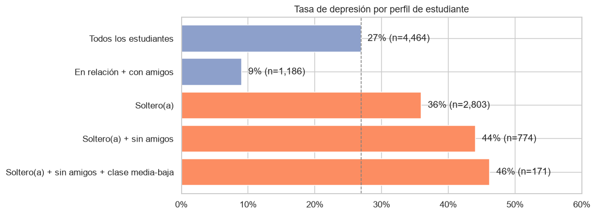
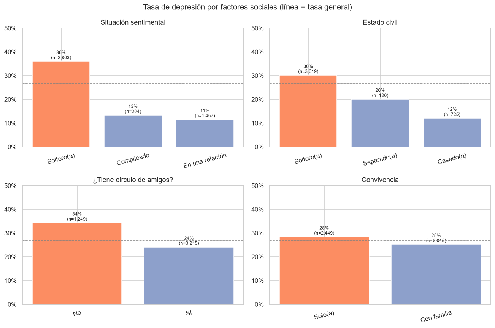
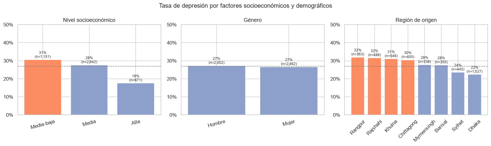
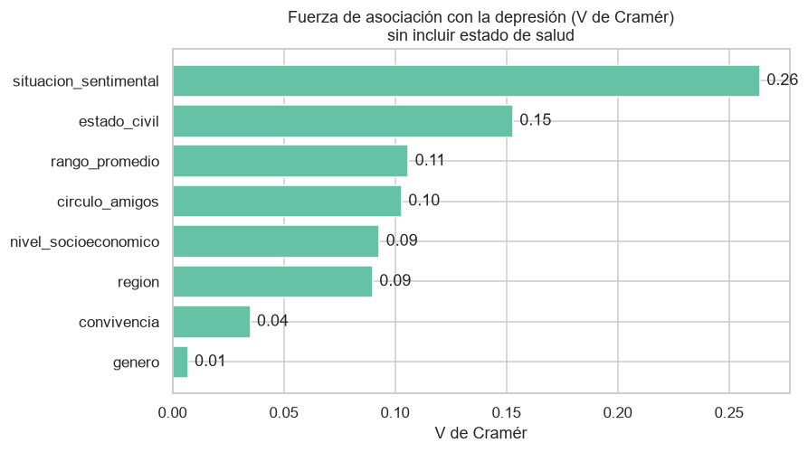

# 🎓 Factores Asociados a la Depresión en Estudiantes Universitarios


<a href="https://colab.research.google.com/github/NathaliaVal08/analisis-depresion-estudiantes/blob/main/notebooks/analisis_depresion_estudiantes.ipynb"></a>

## 📌 Resumen

> **1 de cada 4 estudiantes (26.9%) reporta depresión.** Los estudiantes **solteros(as) y sin círculo de amigos** la reportan en un **44%**, mientras que quienes tienen **pareja y amigos** solo en un **9%**. Las redes de apoyo, el nivel socioeconómico y el rendimiento académico son los factores más asociados. **El género no muestra diferencias.**



## 🎯 Objetivo de Negocio

Una universidad quiere **priorizar sus programas de bienestar estudiantil** con un presupuesto limitado. Este análisis identifica **qué perfiles de estudiantes reportan depresión con mayor frecuencia**, para enfocar los recursos donde pueden tener más impacto.

### Preguntas que guiaron el análisis
- ¿Qué porcentaje de estudiantes reporta depresión?
- ¿Qué factores sociales, económicos y académicos se asocian más con la depresión?
- ¿Qué tan fuerte es cada asociación y es estadísticamente significativa?
- ¿Qué perfiles de estudiantes deberían priorizarse?

## 📊 Datos Utilizados

**Fuente:** [Student Depression Detection Dataset – Kaggle](https://www.kaggle.com/datasets/mkhoirulmustaqim/student-depression-detection-dataset)

**Tamaño:** 4,464 estudiantes universitarios de Bangladesh · 13 variables · sin valores nulos ni duplicados.

| Tipo | Variables |
|---|---|
| Sociales | Situación sentimental, estado civil, círculo de amigos, convivencia |
| Socioeconómicas | Nivel socioeconómico, gasto mensual, región de origen |
| Académicas | Promedio (CGPA), semestre |
| Demográficas | Género, edad |
| Salud | Estado de salud autorreportado |
| **Objetivo** | **Depresión (Sí / No)** |

## 🧹 Preparación y Calidad de Datos

- ✅ Revisión de nulos, duplicados y tipos de datos.
- ✅ Validación de **reglas de negocio**, no solo de datos faltantes:
  - 42 estudiantes en semestre 0 y 2 con gasto mensual 0 (se conservan y se documentan).
  - 201 registros con situación *"Soltero(a)"* y estado civil *"Casado(a)"* a la vez (inconsistencia de la encuesta).
- ✅ Traducción de columnas y categorías al español.
- ✅ Creación de rangos de promedio académico.
- ⚠️ Detección de una posible **fuga de información (data leakage)** en la variable de estado de salud (ver hallazgos).

## 🔍 Metodología

1. **Análisis exploratorio:** tasa de depresión por cada factor, comparada contra la tasa general.
2. **Validación estadística:** prueba **chi-cuadrado** para confirmar que las diferencias no son por azar y **V de Cramér** para medir la fuerza de cada asociación.
3. **Segmentación:** combinación de factores para construir **perfiles de riesgo**.

## 💡 Principales Hallazgos

### 1. Las redes de apoyo son el factor social más asociado
Los estudiantes **solteros(as)** reportan depresión **3 veces más** que quienes están en una relación (36% vs. 11%). **No tener círculo de amigos** sube la tasa a 34%.



### 2. El nivel socioeconómico y la región importan; el género no
La tasa baja de **31% en clase media-baja a 18% en clase alta**. Dhaka, la capital, tiene la tasa más baja (22%). **Hombres y mujeres reportan lo mismo (27%).**



### 3. El bajo rendimiento académico es una señal de alerta
Los estudiantes con **promedio ≤ 3.0 reportan 36%**, frente a 22% en los mejores promedios.

### 4. Ranking de factores (V de Cramér)



| Factor | V de Cramér | ¿Significativo? |
|---|---|---|
| Situación sentimental | 0.26 | ✅ Sí |
| Estado civil | 0.15 | ✅ Sí |
| Rango de promedio | 0.11 | ✅ Sí |
| Círculo de amigos | 0.10 | ✅ Sí |
| Nivel socioeconómico | 0.09 | ✅ Sí |
| Región | 0.09 | ✅ Sí |
| Convivencia | 0.04 | ✅ Sí (muy débil) |
| Género | 0.01 | ❌ No |

### 5. ⚠️ Alerta de calidad: estado de salud
El **100%** de estudiantes con salud "Crítica" reporta depresión y el **0%** con salud "Buena" (V de Cramér = 0.81). Una relación tan perfecta indica que la variable probablemente **se derivó del mismo diagnóstico** o que el dataset es **sintético**. Usarla en un modelo predictivo generaría **fuga de información**, por eso se excluyó del ranking.

## 🏥 Recomendaciones para el Negocio

| Prioridad | Acción | Población objetivo |
|---|---|---|
| 🔴 Alta | Grupos de integración y mentorías entre pares | Estudiantes sin círculo de amigos |
| 🔴 Alta | Alertas tempranas desde el área académica hacia bienestar | Estudiantes con promedio ≤ 3.0 |
| 🟠 Media | Becas y apoyo económico con acompañamiento psicológico | Clase media-baja |
| 🟠 Media | Programas de bienestar en regiones fuera de la capital | Rangpur, Rajshahi, Khulna, Chittagong |

👉 Un programa enfocado en los **774 estudiantes solteros(as) y sin amigos** llegaría a una población con **1.6 veces** la prevalencia general.

## ⚠️ Limitaciones

- Datos **autorreportados** y de **un solo momento**: muestran asociación, **no causalidad**.
- Posible **dataset sintético** (por la variable de estado de salud).
- Población de **Bangladesh**: los resultados no se generalizan directamente a otros países.
- Este análisis **no es un diagnóstico clínico** y no debe usarse para etiquetar personas.

## 🚀 Próximos Pasos

- [ ] Modelo de clasificación interpretable (regresión logística) **sin** la variable de salud.
- [ ] Dashboard en **Power BI** para filtrar perfiles por región y nivel socioeconómico.

## 🛠️ Herramientas Utilizadas

- Python · Pandas · NumPy
- Matplotlib · Seaborn
- SciPy (chi-cuadrado, Mann-Whitney)
- Jupyter Notebook / Google Colab

## 📁 Estructura del Proyecto

```
analisis-depresion-estudiantes/
├── data/
│   └── raw/
│       └── Student_Depression_Dataset.csv
├── images/                 # Gráficos generados por el notebook
├── notebooks/
│   └── analisis_depresion_estudiantes.ipynb
├── requirements.txt
└── README.md
```

## ▶️ Cómo Ejecutarlo

**Opción 1:** haz clic en el botón **Open in Colab** de arriba.

**Opción 2 (local):**
```bash
git clone https://github.com/NathaliaVal08/analisis-depresion-estudiantes.git
cd analisis-depresion-estudiantes
pip install -r requirements.txt
jupyter notebook notebooks/analisis_depresion_estudiantes.ipynb
```

## 👩‍💼 Sobre mí

Soy **Nathalia Stefania Valbuena Moreno**, Administradora de Empresas con más de 13 años de experiencia en análisis de costos y control de información operativa en el sector de alimentos. Hoy combino esa experiencia de negocio con Python, SQL y Power BI para convertir datos en decisiones.

💼 [LinkedIn](https://www.linkedin.com/in/nathalia-valbuena) · 🐙 [GitHub](https://github.com/NathaliaVal08)
